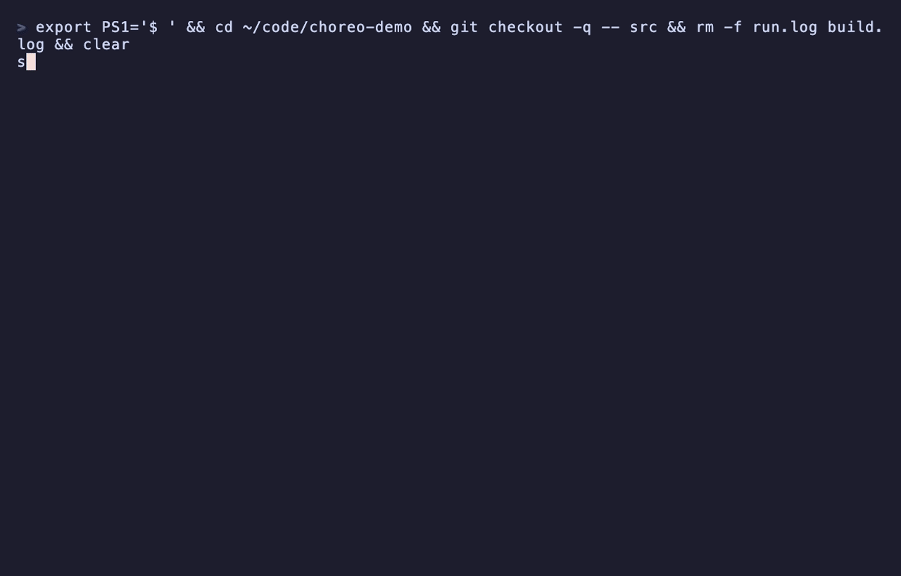

# choreo-demo

A three-role choreography in [March](https://march-lang.org), one OS process per role.



```march
@[endpoints]
protocol Order do
  role Stock needs IO.Console
  role Ledger needs IO.Console
  loop do
    want: Shop -> Stock : Int
    choose by Stock:
      have -> Stock -> Shop : Int
              book: Stock -> Ledger : Int
              booked: Ledger -> Shop : Int
      out  -> Stock -> Shop : Int
              skip: Stock -> Ledger : Int
              stop
    end
  end
end
```

`Order` is the whole conversation, written once from above. Shop asks Stock for items
1, 2, 3, …. While Stock has the item it quotes a price, tells Ledger to book it, and
Ledger tells Shop the running total. When Stock runs out it tells both, and the session
ends. The compiler projects the protocol to a typed API for each role (a multiparty
session type), and each role's code in `src/choreo_demo.march` can only follow its own
projection.

## Install March 0.5.0

```
curl -fsSL https://github.com/march-language/march/releases/download/v0.5.0/install.sh | sh
```

or, with forge already installed, `forge toolchain install v0.5.0`. This repo pins 0.5.0
in `.march-version`.

## Run it

```
forge topology check
forge run --processes --hot-reload
```

`topology.toml` places each role in its own pool, so `forge run --processes` starts three
processes (`warehouse`, `books`, `shop`), a cluster on this machine. Shop runs a session
across them every few seconds:

```
[shop-1] shop:   want item 1
[warehouse-1] stock:  item 1 in stock
[books-1] ledger: booked item 1, total 10
[shop-1] shop:   got it for 10, total 10
…
[warehouse-1] stock:  item 4 sold out
[books-1] ledger: nothing to book for item 4
[shop-1] shop:   sold out, done
```

Ctrl-C drains and stops all three.

## Watch a node

`--hot-reload` gives each process a read-only observe socket next to its reload socket.
`forge run` prints where (`reload server listening on …/.forge/run/books-1.sock`; a long
project path moves it under `/tmp/march-forge-…/`):

```
forge observe --socket .forge/run/books-1.sock.observe
```

opens a live view of that node (its actors, mailboxes, memory, schedulers and code epoch)
while the sessions keep running. `--panel system` prints a one-shot summary.

## Break it

In `Warehouse.stock`, end the session without telling Ledger:

```march
-- before
Order_Stock.close(s, Order_Stock.send_Skip(s, st2, item))
-- after
Order_Stock.close(s, st2)
```

`march --check --topology .forge/topology.json src/choreo_demo.march` rejects it:

```
expected `S_end` but got `S_send_Skip`. [type_mismatch]

56 |           Order_Stock.close(s, st2)
                                    ^^^
```

Stock still owes Ledger the `skip` message, so the session cannot end yet. Sending out of
turn, sending the wrong type, or skipping a reply are rejected the same way.

## The recording

`demo.tape` is a [vhs](https://github.com/charmbracelet/vhs) script for the clip:
`vhs demo.tape` renders `demo.mp4` and `demo.gif`.
